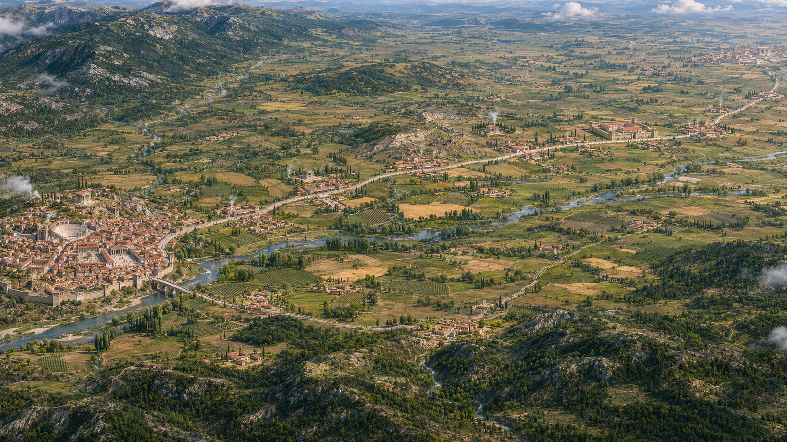
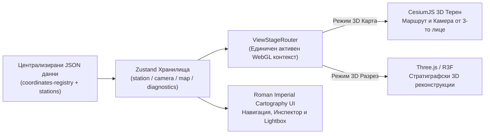

# VIA DIAGONALIS — Interactive Historical 3D WebGIS Explorer

> **„По следите на древния римски път“** — от *Philippopolis* (Пловдив) през Горнотракийската низина, Сакар и Източна Тракия до *Byzantium / Constantinopolis* (Истанбул), с основен исторически фокус около **117 г. сл. Хр.**



[](./tsconfig.json)
[](./package.json)
[](./src/engine/cesium/CesiumGlobeCanvas.tsx)
[](./src/engine/three/HistoricalSceneCanvas.tsx)
[](./TEST_REPORT.md)

---

## English Summary

**VIA DIAGONALIS** (`roman-interactive-map`) is an interactive 3D WebGIS and digital archaeology platform reconstructing the Thracian and East-Thracian trunk of the Roman **Via Militaris / Via Diagonalis** from **Philippopolis** (modern Plovdiv, Bulgaria) to **Byzantium / Constantinopolis** (modern Istanbul, Turkey) c. **117 AD** (276 Roman miles / ~408 km).

- **Dual 3D Engine Architecture**: **CesiumJS** powers real 3D DEM terrain, river basins, curvilinear Catmull-Rom Roman road geometry, and spring-damped third-person aerial camera flight; **Three.js / React Three Fiber** powers separate local 3D stratigraphic & architectural cutaways (only one WebGL context active at a time).
- **Scientific Epistemology**: Distinguishes attested archaeological facts, epigraphic evidence (*IGBulg*, *CIL* III 6123), ancient itineraries (*Itinerarium Antonini*, *Itinerarium Burdigalense*, *Tabula Peutingeriana*), and hypothetical corridors (e.g. *Mutatio Palae* ±4.5 km).
- **100% Original Visual Reference Preservation**: Integrates 9 SHA-256 byte-verified original visual reference artworks (`public/assets/historical-references/`) with native aspect ratios, zero cropping, and an interactive Lightbox (`Zoom`, `Pan`, `1:1 Pixel View`).

---

## 1. Описание на проекта (Български)

**VIA DIAGONALIS** пресъздава в реална триизмерна географска среда централната сухопътна артерия на Римската империя на Балканите през **117 г. сл. Хр.** (прехода между управлението на император Траян и император Адриан).

### Основни възможности
- **Реален 3D релеф (DEM) без задължителен API ключ**: работи автоматично с *Esri WorldElevation3D* (с опционално надграждане към *Cesium World Terrain* чрез `VITE_CESIUM_ION_TOKEN`) и включва резервна локална картографска мрежа при офлайн среда.
- **Пълно трасе от 11 исторически спирки + 9 междинни станции**:
  1. **Филипопол** (*Philippopolis / Trimontium*, гр. Пловдив — `0 m.p.`)
  2. **Сернота** (*Mutatio Sernota*, район с. Маноле — `10 m.p.`)
  3. **Паремболе** (*Mutatio Parembole*, район с. Белозем, надпис на Нерон от 61 г. — `18 m.p.`)
  4. **Карасура** (*Mutatio Carassura*, с. Рупките — `39 m.p.`)
  5. **Арзус** (*Mansio Arzus*, с. Калугерово, р. Сазлийка — `68 m.p.`)
  6. **Пале** (*Mutatio Palae*, хипотетичен район Тянево–Овчарово–Сакарци — `75 m.p.`)
  7. **Кастра Рубра** (*Mansio Castra Rubra*, с. Изворово, Сакар — `86 m.p.`)
  8. **Бурдипта** (*Mansio Burdipta*, м. Хисаря при Свиленград / с. Момково — `104 m.p.`)
  9. **Ускудама / Адрианопол** (*Uscudama / Hadrianopolis*, гр. Одрин — `128 m.p.`)
  10. **Перинт (Хераклея)** (*Perinthus / Heraclea*, гр. Мармара Ерейлиси — `214 m.p.`)
  11. **Византион / Константинопол** (*Byzantium / Constantinopolis*, гр. Истанбул — `276 m.p.`)
- **Камера от трето лице и локална 3D инспекция**: плавни преходи без телепортиране, 5 готови перспективи, прогресивно разгръщане на каменната настилка по маршрута и орбитално обследване на всяка станция.
- **Непокътнати оригинални изображения**: 9 оригинални визуални референции с Lightbox (`Zoom In / Out`, `Pan`, `1:1 Пълен размер`, `Reset Zoom`), напълно отделени от 3D геометрията.
- **Българска историческа информационна система**: четим екскурзоводски разказ за всяка спирка, епистемологичен панел с 4 нива на достоверност, интерактивна хронология (I в. пр.Хр. – VI в. сл.Хр.) и библиографски препратки към *Pleiades*.

---

## 2. Технологичен стек и архитектура

| Слой | Технологии |
| :--- | :--- |
| **UI & State** | React 18, TypeScript 5.6 (`strict`), Zustand 5, Tailwind CSS 3.4, Lucide Icons |
| **3D WebGIS двигател** | CesiumJS 1.123 (`requestRenderMode: true`, процедурна римска каменна настилка, динамичен LOD) |
| **3D Археологически сцени** | Three.js 0.170, `@react-three/fiber`, `@react-three/drei` |
| **Build & QA** | Vite 5.4, `vite-plugin-static-copy`, автоматизиран одит `scripts/qa-audit.mjs` |



---

## 3. Инсталация и стартиране

### Изисквания
- **Node.js** `>= 18.x` (препоръчително `20.x+`)
- Съвременен уеб браузър с поддръжка на **WebGL 2.0**

### Команди

```bash
# Клониране на хранилището
git clone https://github.com/BLGofficial/roman-interactive-map.git
cd roman-interactive-map

# Инсталиране на зависимостите
npm install

# Стартиране в режим на разработка (http://localhost:5173)
npm run dev

# Статична проверка на типовете (TypeScript strict)
npm run typecheck

# Продукционна компилация в dist/
npm run build

# Локален преглед на продукционния билд
npm run preview

# Пълен автоматизиран географски, функционален и SHA-256 одит (21 проверки)
npm run qa
```

### Опционални променливи на средата (`.env`)
Създайте `.env` по образеца на `.env.example`, само ако желаете да използвате собствен ключ за *Cesium World Terrain*:

```env
VITE_CESIUM_ION_TOKEN=your_cesium_ion_token_here
```

---

## 4. Управление

- **Горна лента**: *Начало* · *Маршрут* · *Исторически спирки* · *Хронология* · *За проекта*, превключвател **3D Карта / 3D Разрез** и **Галерия**.
- **Долен контролен панел**: `Zoom In / Out`, `Orbit`, `Reset`, `Предишна спирка`, `Следваща спирка`, `Проследи`, `Пълен маршрут` и меню `Камера` (5 перспективи).
- **Клавиатура**:
  - `W / A / S / D` или `Стрелки` — плавно въздушно движение над релефа
  - `Q / E` — орбитално завъртане около фокуса
  - `+ / -` — приближаване и отдалечаване
  - `1 .. 5` — директно превключване на 5-те режима на камерата
  - `[` и `]` — предишна / следваща историческа спирка
  - `R` / `O` / `Esc` — нулиране на камерата / пълен маршрут / изход от модал или инспекция
- **Мишка и сензорен екран**: двоен клик върху релефа за фокус върху избрана точка; на мобилни устройства — 1 пръст за ротация, щипване с 2 пръста за мащабиране и плъзгане с 2 пръста за *pan*.

---

## 5. Пълна проектна документация

- [**ARCHITECTURE.md**](./ARCHITECTURE.md) — модулна архитектура, разделение на CesiumJS и Three.js, оптимизация на производителността и обработка на грешки.
- [**HISTORICAL_DATA.md**](./HISTORICAL_DATA.md) — координати (`WGS84`), антични извори, хронологичен срез за 117 г. сл. Хр. и епистемологична скала.
- [**ASSET_MANIFEST.md**](./ASSET_MANIFEST.md) — криптографски манифест (SHA-256 и размери) на деветте оригинални визуални референции.
- [**TEST_REPORT.md**](./TEST_REPORT.md) — резултати от функционалните, географските, визуалните и WebGL проверките.
