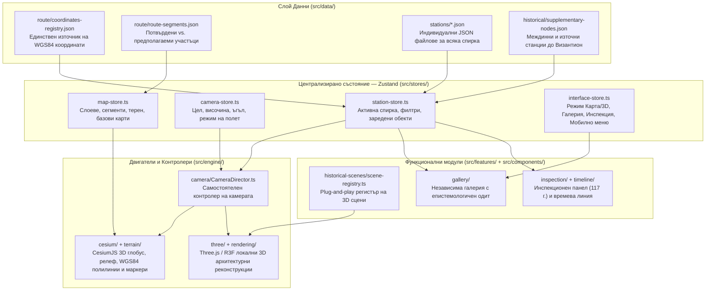

# P02 — Системна архитектура: VIA DIAGONALIS — Interactive Historical Explorer

## 1. Архитектурна визия и разделение на отговорностите

Приложението **VIA DIAGONALIS — Интерактивен исторически изследовател** е проектирано като двуслойно пространствено-историческо уеб приложение (WebGIS + локални 3D реконструкции), базирано на изследователските данни от **P01** за Римска Тракия около **117 г. сл. Хр.**

Основният инженерен принцип е **строгото разделение между географския двигател, специализирания 3D реконструкционен двигател и мултимедийната галерия**, без дублиране на координати, рендеринг или състояние:

---

## 2. Граници между подсистемите (Anti-Duplication Contract)

| Подсистема | Какво управлява | Какво НЕ управлява |
|---|---|---|
| **CesiumJS (`src/engine/cesium/`, `src/engine/terrain/`)** | Световен 3D елипсоид и релеф (WGS84 / `EPSG:4326`), сателитни/исторически тайлове, геореферирани полилинии на *Via Diagonalis* (`confirmed` срещу `hypothetical_or_inferred`), речни преходи, маркери на станциите и коридорни полети. | Не зарежда тежки архитектурни мешове и не управлява локални интериорни/конструктивни разрези или галерийни модали. |
| **Three.js / React Three Fiber (`src/engine/three/`, `src/features/historical-scenes/`)** | Специализирани 3D исторически сцени в локална метрична координатна система (напр. стратиграфски разрез на римската настилка *statumen–rudus–nucleus–pavimentum*, крайпътна станция *mansio/mutatio*, милиарна колона и мостов устой за 117 г.). | Не изчислява геодезични проекции, не дублира глобалната карта и не държи собствени географски координати. |
| **Camera Controller (`src/engine/camera/`)** | Самостоятелен модул (`CameraDirector`), който превежда команди от `camera-store.ts` (напр. `focusStation`, `flyOverview`, `stepCorridor`) към активния двигател с плавни преходи. | UI компонентите никога не извикват директно `viewer.camera.flyTo()` — те комуникират само с `camera-store` / `useCameraController`. |
| **Галерия (`src/features/gallery/`)** | Напълно отделен React слой за визуални реконструкции, карти и епистемологични бележки (Факт / Археологическа интерпретация / Хипотеза / Художествена реконструкция + открити анахронизми за 117 г.). | Няма никакви импорти от `cesium` или `three`; работи и при паузиран/скрит 3D канвас. |

---

## 3. Централизация на координатите и модулно зареждане на локации

1. **Единствен източник на координати (`src/data/route/coordinates-registry.json`):**
   - Всички географски координати (`lat`, `lon`, `uncertaintyRadiusKm`, `pleiadesId`, `precision`) се съхраняват **единствено** в `coordinates-registry.json`.
   - Индивидуалните файлове на станциите (`src/data/stations/01-philippopolis.json` … `08-burdipta.json`) съдържат само `coordinateKey` (напр. `"STOP-01"`). При зареждане `src/utils/coordinates.ts` свързва записа с централния регистър.
2. **Автоматично откриване на нови исторически локации (`import.meta.glob`):**
   - `src/features/stations/station-loader.ts` зарежда динамично всички JSON файлове в `src/data/stations/*.json`.
   - Добавянето на нова спирка (напр. `09-uscudama.json` или `10-perinthus.json`) изисква само:
     1. Добавяне на координатата в `coordinates-registry.json`;
     2. Създаване на новия JSON файл в `src/data/stations/`.
     Нито един ред в `engine/cesium/` или UI компонентите не се нуждае от промяна.
3. **Plug-and-Play регистър за 3D исторически сцени (`src/features/historical-scenes/scene-registry.ts`):**
   - Всяка специализирана R3F сцена се регистрира чрез декларативен дескриптор (`SceneDescriptor`) по `sceneType` или `stationId`.
   - Основният географски двигател (`CesiumGlobeCanvas`) е напълно изолиран от това колко и какви R3F сцени съществуват.

---

## 4. Управление на състоянието (Zustand Stores)

- **`src/stores/map-store.ts`** — видимост на потвърдени и предполагаеми сегменти, междинни/източни станции до Византион, римски мостове, базов картов слой (`satellite` / `topographic` / `dark-arch`), готовност на Cesium и режим на релефа.
- **`src/stores/camera-store.ts`** — текуща цел (`lat`, `lon`, `altitude`, `heading`, `pitch`), активен пресет (`route-overview`, `bulgarian-sector`, `station-close`, `eastern-terminus`) и пореден номер на заявка за полет (`flightNonce`), наблюдаван от `CameraDirector`.
- **`src/stores/station-store.ts`** — колекция от заредените станции, текущо избрана спирка (`selectedStationId`), филтър по достоверност (`ALL`, `HIGH`, `UNCONFIRMED`) и търсене.
- **`src/stores/interface-store.ts`** — активен изглед (`map` срещу `scene3d`), активна 3D сцена, отворена/затворена независима галерия + избран слайд, отворен инспекционен панел, епистемологичен филтър за 117 г. и мобилни чекмеджета (`mobileNavOpen`, `mobileInspectorOpen`).

---

## 5. Конфигурационна система и работа без външни ключове

- Конфигурацията е централизирана в `src/app/config/app-config.ts`.
- При наличен `VITE_CESIUM_ION_TOKEN` в `.env`, `src/engine/terrain/terrain-provider.ts` активира **Cesium World Terrain** с 3D релеф и нормали на осветлението.
- При липса на токен приложението **автоматично превключва към безключов режим** (Esri World Imagery / OpenTopoMap / Carto Dark тайлове + WGS84 елипсоид с атмосферно осветление), осигурявайки 100% работоспособност веднага след `npm install && npm run dev`.

---

## 6. Адаптивност (Mobile-First) и достъпност

- На десктоп (`lg+`): неподвижна горна навигационна лента, ляв компактен списък на спирките, централен 3D viewport (CesiumJS или R3F), десен инспекционен панел за 117 г. и долна времева/маршрутна лента.
- На мобилни устройства (`< lg`): пълноекранен 3D viewport със сгъваеми долни/странични чекмеджета (*bottom sheets / drawers*), големи сензорни зони (`≥ 44px`), клавишна навигация (`Escape`, стрелки за следваща/предишна спирка) и изцяло български потребителски интерфейс.
